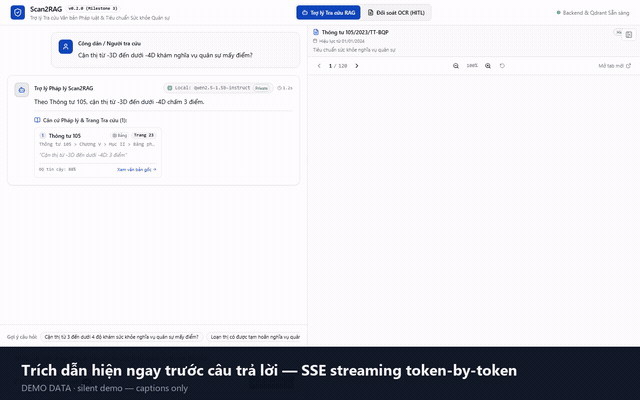

# Vietnamese Document Intelligence (Scan2RAG)

> **Hybrid Local–Cloud RAG & Agentic Document AI for Scanned Vietnamese Documents**  
> *A Production-grade AI Engineering Portfolio Project*

---

## Demo video



[Xem video đầy đủ — 3:00](docs/assets/scan2rag_demo.mp4)

---

## Bắt đầu nhanh

Cài đặt, cấu hình `.env`, sinh artifact dữ liệu, chạy backend/frontend và chạy verify: **[HOW_TO_RUN.md](HOW_TO_RUN.md)**.

---

## Tổng quan dự án (Overview)

**Scan2RAG (Vietnamese Document Intelligence)** là hệ thống AI end-to-end xử lý tài liệu chuyên biệt cho văn bản tiếng Việt dạng **PDF scan / ảnh scan** (chất lượng từ scan văn bản giấy, chứa bảng biểu phức tạp, con dấu, chữ ký và độ nhiễu thực tế).

Dự án ban đầu tập trung vào bộ corpus **pháp luật về khám sức khỏe và tuyển chọn công dân nhập ngũ (nghĩa vụ quân sự tại Việt Nam)**, sau đó được thiết kế dạng module hóa có thể mở rộng (pluggable) phục vụ cho hệ thống tri thức nội bộ doanh nghiệp (**Enterprise Document Intelligence & RAG**).

```
               [ Scanned PDF / Image ]
                          │
                          ▼
            [ OCR & Layout Ingestion ] (PaddleOCR, OpenCV · Docling: planned)
                          │
                          ▼
           [ Structure-aware Chunking ] (Chương / Điều / Khoản / Điểm)
                          │
                          ▼
           [ Hybrid Vector Search DB ] (Qdrant · PostgreSQL: planned)
                          │
                          ▼
         [ Model Router ] (LangGraph compare: additive)
                   /              \
     (Simple / Fast)            (Complex / Reasoning)
           ▼                              ▼
   [ Local LLM (LM Studio) ]    [ Free Cloud LLM (Groq / OpenRouter) ]
                   \              /
                          ▼
              [ Grounded Citations & Output ]
```

---

## Điểm nổi bật & Kỹ thuật chính (Key Highlights)

1. **OCR & Image Preprocessing Pipeline**: Xử lý nghiêng (deskew), khử nhiễu (denoise), tăng tương phản trước khi nhận diện qua `PaddleOCR` (so sánh baseline với `Tesseract`).
2. **Structure-Aware & Parent-Child Chunking**: Khôi phục cấu trúc văn bản pháp luật Việt Nam (`Chương -> Điều -> Khoản -> Điểm`). Khi match một điểm nhỏ, hệ thống tự động bồi đắp context cha (Khoản, Điều).
3. **Document Versioning & Temporal Consistency**: Quản lý mối quan hệ giữa *Văn bản gốc*, *Văn bản sửa đổi* và *Văn bản hợp nhất* nhằm tránh xung đột điều khoản đã hết hiệu lực.
4. **Hybrid Retrieval + Reranking**: Kết hợp Dense Search (`multilingual-e5-small` / `BGE-M3`) và Sparse Search (`BM25`), sau đó rerank qua Cross-Encoder.
5. **Hybrid Local–Cloud Routing**: Định tuyến câu hỏi: tra cứu metadata -> lookup; câu hỏi thông thường -> Local LLM (qua **LM Studio**, tối ưu VRAM); câu hỏi suy luận phức tạp -> Cloud LLM miễn phí qua **Groq** / **OpenRouter** (`:free`) / **Gemini**. LangGraph compare workflow bổ sung tại `POST /api/v1/query/compare`.
6. **Benchmark & Evaluation**: Đo OCR (CER/WER), retrieval (Recall@K, nDCG) và generation (RAGAS: Faithfulness, Answer Relevance). Số liệu đo được và caveat được liệt kê ở mục [Benchmark & kiểm chứng](#benchmark--kiểm-chứng).

---

## Kiến trúc hệ thống (System Architecture)

### 1. Ingestion Pipeline (Offline)
- **PDF Inspection**: Phân loại file (Digital Text PDF, Scanned PDF, hoặc Hybrid PDF).
- **Preprocessing**: Denoising, Deskewing, Thresholding bằng OpenCV.
- **OCR Engine**: Trích xuất text và layout bounding box bằng PaddleOCR.
- **Human-in-the-loop Correction UI**: Giao diện kiểm tra, so sánh ảnh gốc vs text OCR, lưu vết hiệu chỉnh.
- **Structure Parser & Chunking**: Bóc tách theo cấu trúc phân cấp, sinh metadata chi tiết.
- **Vector Storage**: Embeddings và payload metadata/version được lưu tại Qdrant. PostgreSQL (metadata/versioning quan hệ) là **planned, chưa implement**.

### 2. Query & Serving Pipeline (Online)
- **Query Analyzer & Router**: Phân loại ý định (metadata search, factual single-hop, hay multi-document comparison).
- **Retrieval Engine**: Hybrid search (BM25 + Dense) kết hợp RRF (Reciprocal Rank Fusion) và Reranker.
- **Model Router (đã implement)**: Chọn local/cloud theo độ phức tạp — giữ làm default cho chat.
- **LangGraph Compare Workflow (additive)**: `POST /api/v1/query/compare` — so sánh đa văn bản qua 6 node `plan → retrieve → evidence_check → retry → synthesize → verify_answer`; retry và regenerate đều tối đa 1 lần, `verification` báo số liệu không có trong trích dẫn.
- **Citation Validator**: Đảm bảo mọi câu trả lời đều có trích dẫn chính xác đến `Tên văn bản`, `Điều/Khoản` và `Số trang PDF`.

---

## Môi trường & Cấu hình phần cứng mục tiêu

Dự án được tối ưu hóa để chạy và thử nghiệm trên laptop cá nhân có tài nguyên VRAM hạn chế:
- **CPU**: Intel Core i5-12450H (hoặc tương đương)
- **GPU**: NVIDIA GeForce RTX 3050 Ti (4GB VRAM)
- **RAM**: 16 GB
- **Hệ điều hành**: Windows 11 / WSL2 / Linux

> **Chiến lược tối ưu VRAM (4GB)**:
> - Tách biệt pha Ingestion (OCR, Embedding) và Serving (Query, Local LLM) nhằm tránh Out Of Memory (OOM).
> - Ưu tiên model Local LLM quantized nhẹ: `Qwen2.5-1.5B-Instruct` hoặc `Qwen2.5-3B-Instruct` load qua **LM Studio Local Server** (cung cấp endpoint chuẩn OpenAI tại `http://localhost:1234/v1`).
> - Với các tác vụ reasoning nặng: Chuyển tiếp lên **Groq** (siêu tốc, free tier rộng rãi) hoặc **OpenRouter** (sử dụng các model `:free`).

---

## Model & cấu hình

| Vai trò | Model / cấu hình mặc định | Nguồn |
|---|---|---|
| Embedding | `intfloat/multilingual-e5-small` (prefix `passage:` / `query:`, 384 chiều, L2-normalized) | `EMBEDDING_MODEL_NAME` trong `.env.example` |
| Reranker | `BAAI/bge-reranker-base` (CrossEncoder, mặc định CPU để giữ VRAM cho LM Studio) | `RERANKER_MODEL_NAME` |
| LLM local | `qwen2.5-1.5b-instruct` / `qwen2.5-3b-instruct` qua LM Studio `http://localhost:1234/v1` | `LOCAL_LLM_MODEL`, `LM_STUDIO_BASE_URL` |
| Cloud mặc định | Groq `qwen/qwen3.8-27b` | `DEFAULT_CLOUD_PROVIDER=groq`, `GROQ_MODEL` |
| Cloud `:free` | OpenRouter `google/gemma-4-26b-a4b-it:free` | `OPENROUTER_MODEL` |
| Cloud fallback | Gemini `gemini-3.5-flash-lite` | `GEMINI_MODEL`, `GEMINI_URL` |
| OCR | PaddleOCR tiếng Việt + OpenCV deskew/denoise | `OCR_ENGINE`, `USE_GPU_OCR` |

> Với máy 4GB VRAM: chạy Ingestion (OCR/Embedding) và Serving (LLM) ở **hai pha riêng**; model local dùng bản quantized Q4_K_M. Cấu hình chi tiết xem [HOW_TO_RUN.md](HOW_TO_RUN.md).

---

## Benchmark & kiểm chứng

| Nhóm | Chỉ số đo được | Artifact nguồn |
|---|---|---|
| Corpus | 5 văn bản · 287 trang · 111 bảng (111/111 đã rectify) | `data/benchmarks/ocr_comparison/benchmark_summary.json` |
| OCR/VLM | 59 bảng Qwen3-VL-4B + 52 bảng Gemini auditor · 13.548 ô · `invalid_score_cells=0` | `benchmark_summary.json`, `data/benchmark_milestone3_report.json` |
| Chunking | 6.786 node · 28 orphan (0,41%) · 0 node rỗng | `data/benchmark_milestone3_report.json` |
| Retrieval (RAGAS M2) | 50 query · retrieval 96% · trích dẫn đúng 86% · faithfulness 82% · latency trung bình 12.720,9 ms | `data/benchmarks/ragas_milestone2_report.json` |
| Index consistency | 7.259 / 7.259 / 7.259 (chunker / BM25 / Qdrant) · 0 breadcrumb `> DOCUMENT` | `docs/ai-context/KNOWN_TRAPS.md` §5 |
| Serving (M3) | quality 100/100 · `eval_passed=true` · latency trích dẫn TB 5.290,4 ms | `data/benchmark_milestone3_report.json` |
| HITL | 24 ngoại lệ điểm có `reason/reviewer/timestamp` · number-lock 0 breach | `KNOWN_TRAPS.md` §2, §6 |

> **Caveat:** report RAGAS M2 là snapshot đã migrate schema (`migrated_from_legacy: true`), **không chạy lại LLM**. Report M3 có `overall_quality_score=100` nhưng `overall_passed=false` vì `citations_under_1s=false` — không diễn giải thành "mọi benchmark đều xanh". Các số trên là bằng chứng tại thời điểm tạo artifact, không phải cam kết trên dữ liệu mới.

---

## Tech Stack

| Thành phần | Công nghệ lựa chọn | Vai trò |
| :--- | :--- | :--- |
| **Backend** | Python 3.10+, FastAPI | REST API & Core Engine |
| **PDF Processing** | PyMuPDF (fitz) | Đọc, phân tích, render PDF |
| **Image Preprocessing**| OpenCV, Pillow | Deskew, Denoise, Binarization |
| **OCR Engine** | PaddleOCR, Tesseract (baseline) | Nhận diện văn bản tiếng Việt & Layout |
| **Table Extraction** | PaddleOCR layout + VLM rectifier (Docling: planned) | Phân tích bảng biểu tiêu chuẩn sức khỏe |
| **Embeddings** | `multilingual-e5-small`, `BGE-M3` | Sinh vector ngữ nghĩa |
| **Vector Database** | Qdrant | Lưu trữ và tìm kiếm vector |
| **Relational Database**| PostgreSQL (Test/Prod) — **planned, chưa implement** | Dự định lưu metadata, versioning, logs, user |
| **Local LLM** | LM Studio (`http://localhost:1234/v1`) | Chạy suy luận cục bộ bằng Qwen2.5 GGUF |
| **Cloud LLM (Free)**| Groq API, OpenRouter (`:free`) | Suy luận đa tài liệu, reasoning miễn phí |
| **Agent Framework** | Model router (default) · LangGraph (additive) | Routing local/cloud; graph so sánh đa văn bản tại endpoint riêng |
| **Evaluation** | RAGAS, Custom Evaluation Suite | Đánh giá CER, WER, Recall@K, Faithfulness |
| **Frontend** | React + TypeScript (Vite, Tailwind) | Giao diện Chat, Review OCR, Dashboard |

---

## Cấu trúc thư mục (Project Structure)

```text
Scan2RAG/
├── README.md
├── HOW_TO_RUN.md                       # Cài đặt, chạy, verify, regenerate demo
├── .gitignore
├── .env.example
├── docker-compose.yml
├── docs/
│   ├── project-blueprint-and-specs.md   # Đặc tả kỹ thuật & Lộ trình chi tiết
│   ├── architecture/                   # Tài liệu thiết kế kiến trúc
│   └── research/                       # Báo cáo benchmark (OCR, Chunking, Retrieval)
├── backend/
│   ├── app/
│   │   ├── main.py
│   │   ├── api/                        # FastAPI routes & dependencies
│   │   ├── core/                       # Config, logging
│   │   ├── ingestion/                  # PDF loader, OCR, preprocessing, parser
│   │   ├── chunking/                   # Structure-aware, parent-child chunkers
│   │   ├── embeddings/                 # Embedding service
│   │   ├── retrieval/                  # Dense, Sparse, Hybrid search & Reranker
│   │   ├── llm/                        # Local & Cloud model clients, Router
│   │   ├── agents/                     # LangGraph compare workflow (additive)
│   │   └── database/                   # PostgreSQL models (planned, chưa tạo); Qdrant ở retrieval/
│   └── tests/
├── frontend/                           # React + TypeScript App
├── evaluation/
│   ├── datasets/                       # Question sets & Ground truth
│   ├── ocr/                            # CER/WER scripts
│   ├── retrieval/                      # Recall, MRR, nDCG benchmarks
│   └── reports/                        # Báo cáo kết quả đánh giá
├── data/                               # Dữ liệu cục bộ (ignored in git)
│   ├── raw/                            # PDF scan gốc
│   ├── processed/                      # Text, JSON cấu trúc sau OCR
│   └── exports/
└── scripts/                            # Scripts tiện ích chạy pipeline
```

---

## Giới hạn đã biết

- **Phần cứng:** tối ưu cho laptop 4GB VRAM; không chạy đồng thời OCR + Embedding + Local LLM.
- **Artifact dữ liệu:** `data/raw/*.pdf`, `data/processed/*.json`, `data/bm25_index.json` bị gitignore — clone sạch không có, phải tạo local (xem [HOW_TO_RUN.md](HOW_TO_RUN.md)).
- **CI vs local:** CI chạy 5 gate không cần artifact; 11 gate (gồm corpus/score/vector/benchmark/backend-tests) chỉ chạy đủ trên máy có dữ liệu — xem `docs/ai-context/TESTING_GUIDE.md` §2.
- **Demo PDF:** video/GIF quay bằng Chromium headless (không có plugin xem PDF) với file mock 1 trang → vùng xem PDF bị trắng; UI vẫn hiện metadata/breadcrumb và toolbar. Đây là giới hạn của khâu quay demo, không phải lỗi sản phẩm.
- **Chưa implement (planned):** PostgreSQL, Docling — đối chiếu `docs/ai-context/ARCHITECTURE.md`. LangGraph đã có dạng additive tại endpoint `/api/v1/query/compare`.

---

## Tài liệu kỹ thuật chi tiết

Kiến trúc, bảng phân tích rủi ro và thông số metric được lưu tại:  
**[Tài liệu Đặc tả Kỹ thuật Toàn diện (Project Blueprint & Specs)](docs/project-blueprint-and-specs.md)** · **[docs/ai-context/](docs/ai-context/README.md)**
